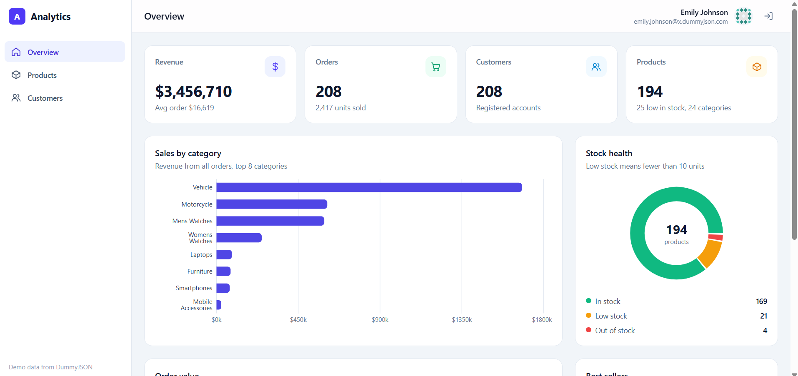
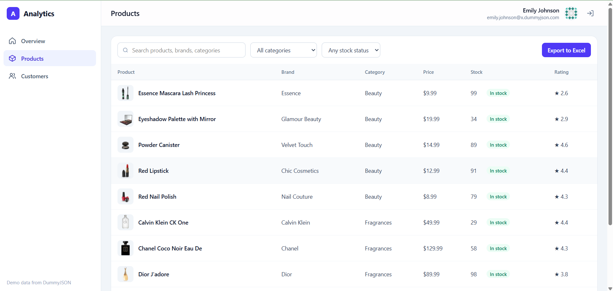
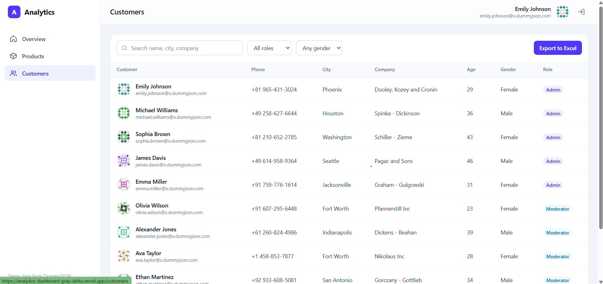

# Analytics Dashboard

An admin dashboard for an online store: sign in, see key metrics and charts, and manage products and customers in searchable, sortable tables with Excel export.

**Live demo:** https://YOUR-LINK.vercel.app  
**Demo login:** `emilys` / `emilyspass` (or click "Fill demo credentials" on the login page)



## Features

- **Authentication** with token-based login, protected routes, persisted session and automatic logout when the token expires
- **KPI cards** for revenue, orders, customers and products, loaded in parallel
- **Charts** (Recharts): sales by category, stock health donut, order value distribution, best sellers
- **Products and Customers tables** (TanStack Table v9): debounced search, column filters, sorting, pagination with page size
- **Excel export** of the current filtered and sorted rows
- **Loading skeletons, error states with retry, empty states**
- **Responsive layout** with a slide-in sidebar on mobile
- **Route-level code splitting**: chart, table and Excel code only load when needed

| Products | Customers |
| --- | --- |
|  |  |

## Tech stack

React 19, TypeScript, Vite, Tailwind CSS v4, React Router, Zustand, Axios, TanStack Table v9, Recharts, write-excel-file. Data from the [DummyJSON](https://dummyjson.com) API.

## Project structure

```
src/
  api/          axios client with auth interceptors, API functions
  store/        Zustand auth store (persisted)
  hooks/        useFetch, useDashboardData, useDebouncedValue
  lib/          shared TanStack Table feature setup
  utils/        formatting, chart data calculations, Excel export
  components/   layout, KPI and chart cards, charts, table components
  pages/        Login, Overview, Products, Customers
```

Chart data is calculated by pure functions in `utils/analytics.ts`, so components only render prepared data.

## Run locally

```bash
npm install
npm run dev
```

Open http://localhost:5173.

## Build

```bash
npm run build
```
